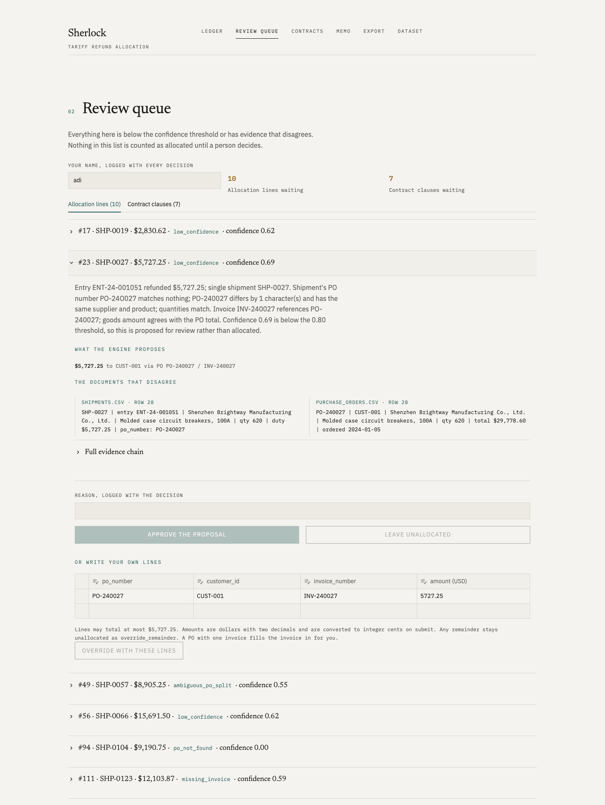

# Sherlock

**The problem.** A tariff refund arrives as one lump sum: one wire, one number, no breakdown. Someone in
finance then has to work out which shipment, purchase order, invoice and customer every dollar belongs to,
and whether each customer's contract entitles them to a share, by hand, in a spreadsheet.

**What Sherlock does.** It reads the refund notice, the shipping records, the POs, the invoices and the
customer contracts, and builds an allocation ledger where every line cites its evidence down to the file
and row. Anything uncertain goes to a human review queue with the model's reasoning and the conflicting
documents side by side; the outputs are an audit memo and a journal-entry CSV for the close.

## One command

```
make install          # Python 3.11+
make demo             # Postgres via docker if available, else SQLite; seeds synthetic_v1; console + API at :8000
```

No API key, Docker or network is needed to run the demo. Model outputs are served from the committed
`llm_cache/`; with `ANTHROPIC_API_KEY` in `.env`, `make llm-cache` refreshes them.



## Financial guarantees

- **Conservation.** Refund total = allocated + unallocated, always, and every unallocated line carries a
  reason. Nothing is force-matched; nothing vanishes.
- **Integer cents** in the database, the API and the exports. Dollars appear only at the screen edge.
- **Nothing below the confidence threshold is counted as allocated.** It is queued with the engine's
  proposal attached, and only a logged human decision moves it.
- **Contract obligations are never auto-confirmed.** The model reads the clause and says how sure it is; a
  person decides.
- **Every decision is logged**: who, when, what changed, why. Overrides supersede lines; they never edit
  money in place.
- **Memo and exports regenerate** from the reviewed ledger on every request.

## Where the AI is used, and where it is not

Claude reads what rules cannot: ten customer contracts with different structures and wording (two of them
deliberately off-template, where the rule-based reader fails and the model does not), and an image-only
scanned invoice that never made it into the books. Everything else is deterministic code with tests. See
`docs/PITCH.md` for the story and `docs/DEMO_PATH.md` for the exact click sequence.

## Swap the dataset

Put a folder matching `docs/DATA_CONTRACT.md` under `data/` and run `make seed DATASET=<folder>`.
Matching tolerances live in `sherlock/matching/config.py`; the rules in `sherlock/matching/rules.py`.

See `CLAUDE.md` for the architecture and developer workflow, and `docs/SPEC.md` for the brief.

## Additional local review demo

The merged `codex/sherlock-demo` implementation is retained under `app/`, with its own database and test fixtures. The console above remains the primary application. To run the additional demo (stop any other app on port 8000 first):

```sh
docker compose -f compose.demo.yaml up --build
```

See [local demo instructions](docs/local-demo.md) for its fixture parser, review workflow, optional AI adapter, and exports. `docker-compose.yml` remains the database configuration used by `make demo`.
